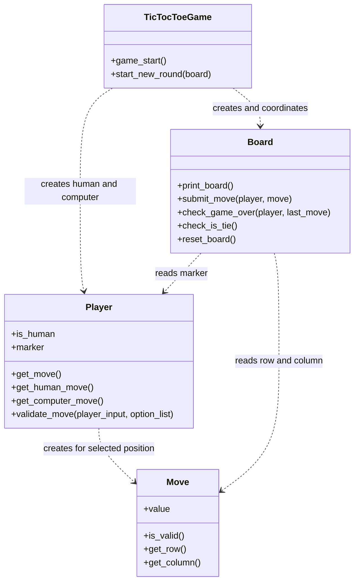
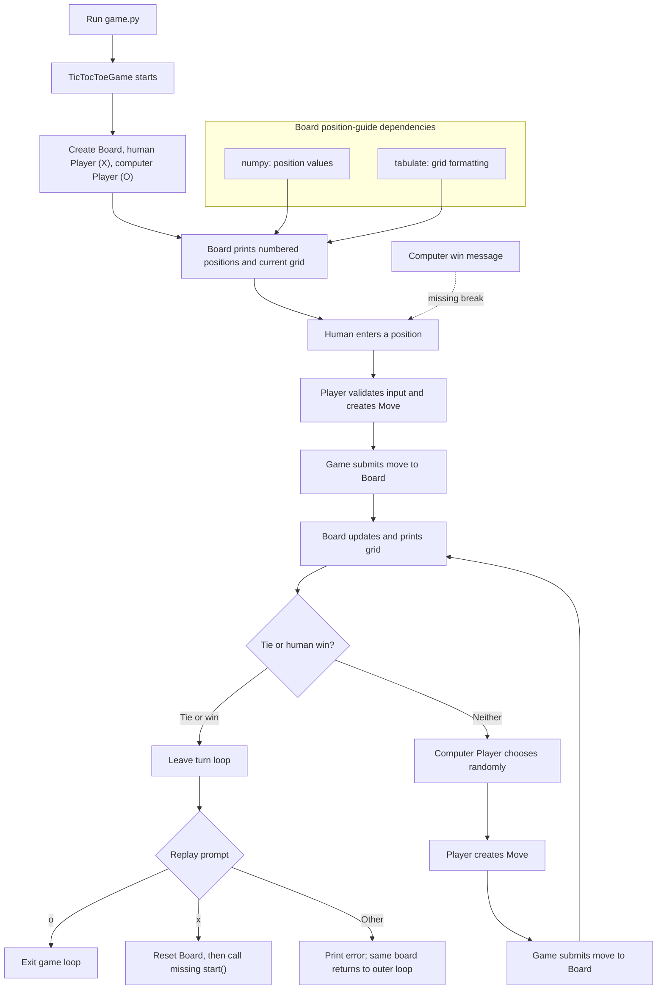

# Tic-Tac-Toe Architecture

This document describes the command-line human-versus-computer game in
`game.py`, `board1.py`, `Player.py`, and `move.py`. It covers the current
implementation, including known broken paths, and distinguishes those facts
from recommended improvements. It does not describe unrelated examples.

## Current implementation

The program is started by running `python game.py`. At module load, `game.py`
constructs a `TicTocToeGame` and calls `game_start()`, which creates a
`Board`, a human `Player` (`X`), and a computer `Player` (`O`). The game
coordinator alternates turns, asks the board to place markers and check
results, and prints the board and prompts to the console.

`Move` represents a numbered position from 1 through 9 and maps it to
zero-based row and column coordinates. `Player` reads human input or chooses
a computer position using Python's `random` module. `Board` owns the 3 × 3
grid, renders it, places markers, and checks for wins and a full-board tie.
Board rendering also uses `numpy` and `tabulate` to print the numbered
position guide.

### Class diagram



### Human-versus-computer sequence

The diagram shows the implemented turn loop, including the computer-win
branch that currently fails to end the round.

```mermaid
sequenceDiagram
    actor Human
    participant Game as TicTocToeGame
    participant HP as Human Player
    participant CP as Computer Player
    participant Move
    participant Board

    Game->>Board: create board
    Game->>HP: create human player (X)
    Game->>CP: create computer player (O)
    Game->>Board: print_board()

    loop Turn loop
        Game->>HP: get_move()
        HP->>Human: prompt for position
        Human-->>HP: enter position
        HP->>HP: validate against temporary options set
        HP->>Move: create Move(position)
        HP-->>Game: return move
        Game->>Board: submit_move(HP, move)
        Game->>Board: print_board()
        Game->>Board: check_is_tie()
        alt Board full
            Board-->>Game: tie
            Note over Game: Breaks turn loop
        else Not full
            Game->>Board: check_game_over(HP, move)
            alt Human wins
                Board-->>Game: win
                Note over Game: Breaks turn loop
            else Human has not won
                Game->>CP: get_move()
                CP->>CP: choose random position from temporary options set
                CP->>Move: create Move(position)
                CP-->>Game: return move
                Game->>Board: submit_move(CP, move)
                Game->>Board: print_board()
                Game->>Board: check_is_tie()
                alt Board full
                    Board-->>Game: tie
                    Note over Game: Breaks turn loop
                else Not full
                    Game->>Board: check_game_over(CP, move)
                    alt Computer wins
                        Board-->>Game: win
                        Note over Game: Prints a win message but does not break; loop continues
                    else No winner
                        Board-->>Game: continue
                    end
                end
            end
        end
    end
    Game->>Human: ask to play again (x) or quit (o)
    alt Enter o
        Game-->>Human: exit
    else Enter x
        Game->>Board: reset_board()
        Game->>Game: call self.start()
        Note over Game: Broken: start() is not defined
    else Other input
        Game-->>Human: print wrong-entry message
        Note over Game: Outer loop resumes without resetting the round
    end
```

### High-level architecture flow



## Broken execution paths in the current code

- **Computer wins do not end the round.** In `game_start()`, the computer-win
  branch prints its message but does not break the turn loop. The next human
  turn can therefore run on an already-won board.
- **Replay raises `AttributeError`.** Choosing `x` resets the board and calls
  `self.start()`, but `TicTocToeGame` has no `start()` method. The players are
  also not recreated by `start_new_round()`.
- **Other replay input does not quit.** The invalid-choice branch prints a
  message but does not break either loop or reset the board; control returns
  to the outer loop and gameplay continues.
- **Available positions are not persistent or shared.** Each `Player` owns
  separate lists, while each `get_move()` creates a temporary set from those
  lists. `validate_move()` removes from that temporary set, not from either
  player's stored lists or the board. The computer can choose an occupied
  position again; `Board.submit_move()` only prints a warning and does not
  request a replacement.
- **Some invalid inputs raise exceptions.** Nonnumeric console input can fail
  at `int(input(...))` with `ValueError`. In `validate_move()`, a retry choice
  is removed from the options set before it is checked for membership; an
  unavailable choice can raise `KeyError`.
- **The program starts on import.** The bottom of `game.py` calls
  `game_start()` at module scope, so importing that module also starts
  interactive gameplay.

## Recommended improvements (not implemented)

- Make `Board` the single source of truth for legal/occupied positions, and
  reject invalid or occupied moves before changing game state.
- Validate console input without allowing `ValueError` or `KeyError` to escape;
  re-prompt for a valid available position.
- End the turn loop immediately on either player's win or on a tie.
- Define one clear replay path that resets the board and player state, and
  make every non-replay response exit cleanly.
- Put startup behind an explicit entry-point guard so importing `game.py`
  does not launch the interactive game.
- Add focused tests for move-to-coordinate mapping, occupied positions,
  win/tie detection, end-of-round control flow, and replay.
- Optionally replace random computer selection with a strategy such as
  minimax; the current computer is random.
